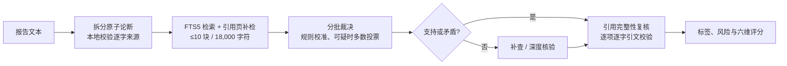

# PaperAudit 论文学习与证据审计

> 犀牛鸟开源实战任务个人作品，非腾讯官方项目。

PaperAudit 是一个面向英文 AI 论文的中文学习与证据审计工具，支持结构化讲解、论文与代码联合阅读、模拟投稿评审和报告论断核验。论文原文、讲解、追问记录与审计历史保存在本地项目工作区中，方便用户从阅读理解、定位证据到导出结果。

## 项目定位

**目标用户**是需要阅读、汇报或复核英文 AI 论文的本科生、研究生、科研新人和工程开发者。

他们面对的核心问题不是“生成一段摘要”，而是论文篇幅长、术语密集，AI 讲解又可能出现数字错误、遗漏实验条件、夸大结论或伪造引用。PaperAudit 将论文讲解与证据审计放在同一工作区，让用户能从中文结论回到 PDF 原文核验，并对已有报告逐条检查。

配置的大模型负责语义理解与结构化判断：拆分原子论断、生成检索查询、判断论断与证据的支持关系。本地程序负责 PDF 解析、候选检索、页码与代码行定位、引用白名单与逐字引文校验和确定性评分，避免让模型自行伪造证据位置。

## 核心功能

- **论文阅读与中文讲解**：上传英文论文 PDF，生成涵盖研究问题、核心贡献、方法、实验、局限性和术语的结构化讲解；章节切换与 PDF 原文联动。
- **论文追问与证据定位**：回答只使用当前论文的检索内容；点击引用即可跳转到对应页码并高亮原文证据。
- **论文与代码联合阅读**：上传配套源码 ZIP，建立文件、符号和行号索引；追问方法实现并定位到对应文件和代码行。
- **可选论文—代码深度调查**：追问代码或论文与代码的对应关系时，模型可通过原生工具调用自主多步查目录、全文查找、定位符号、读取指定行并检索论文，把对照拆成逐条发现，每条单独判定一致、不一致、部分对应或未定位，并各自附代码与论文引用；引用的代码行与论文片段必须是调查中实际读到的内容且逐字可核验，否则只修正一次，仍缺引用的发现逐条剔除，没有任何发现通过时降为证据不足。单次调查最多 10 次模型请求、16 次工具调用；工具只读取上传时建立的内存索引，不执行代码、不联网。调查失败时回退到单次检索回答，轨迹随回答保存。默认关闭（`PAPERAUDIT_CODE_AGENT`，或在提问时勾选“深度调查”）。
- **论文—代码一致性审计**：上传源码后，由编排者先从论文中列出可通过阅读代码核对的要点（超参数、结构、训练与数据处理等，引文须逐字存在于论文），再为每个要点各启动一次独立的调查并行核对，汇总为按“不一致、部分对应、未定位、一致”分组的报告。每次调查有独立的上下文和请求预算，整份审计另有总请求上限（默认 160 次），超出后剩余要点标为未完成；单项失败不影响其他项。编排者只做分派与计数，不自行撰写结论。
- **模拟投稿评审**：按研究价值、创新性、技术可靠性、实验充分性、清晰度和可复现性六个维度生成评审意见与五档预审建议。
- **报告证据审计**：拆分原子论断，核验引用、数字、条件和结论边界，输出支持标签、错误类型、风险等级、六维评分及证据定位。
- **可选深度核验（LangGraph）**：对证据不足的论断，按“规划 → 读取 → 重判 → 结束”四节点图自动补查（全文检索、指定页读取、相邻上下文），最多两轮、12 次请求；结论仍须通过引用校验，调查轨迹随结果保存。默认关闭。
- **审计复核与结果管理**：历史审计、待复核筛选、人工修订对比、Markdown / JSON 导出。

## 审计流程



- **证据检索**：每篇论文在内存中建立 SQLite FTS5 索引，BM25 召回后按查询覆盖、数字与指标共现、配置与资源共现等特征重排；保留全局 Top-5，再优先检索报告所引页面并按坐标补全表格行。超预算的片段整块跳过，不截断或拼接原文。
- **模型输出约束**：证据编号必须属于本次候选；规则校准错误类型与标签；判断不一致时追加裁决并多数投票。
- **引用完整性复核**：支持与矛盾结论需对主体、配置、比较对象、指标、数值等逐项给出逐字引文，程序验证引文确实存在于所选片段；仅对引文转录或编号错误修复一次，语义缺口直接降为待核验。

当前以带文本层的 PDF 为基础，不支持扫描件 OCR、图表视觉理解或跨论文事实核验；代码阅读不执行或复现实验。模拟评审是辅助预审意见，不代表真实会议录用结果。

## 评测摘要

评测单位是原子论断，支持标签、错误类型、风险等级和六个评分维度（事实支持度、证据正确性、证据完整性、数字与指标一致性、内容覆盖度、结论边界）均有可执行定义。除论文—代码调查评测外，原始实验记录未随仓库发布。

- **评测集**：28 篇论文、264 条原子论断，按论文划分开发集、诊断集与最终留出集。
- **最终留出集**（6 篇此前未使用的论文、48 条论断，v1 冻结版本）：Top-5 证据召回率 87.5%（离线检索），标签准确率 83.3%，宏平均 F1 0.80，错误类型准确率 78.8%。
- **评估方法有效性**：高 / 中 / 低质量报告得分排序 5/5 正确；40 条样本重复 3 次，标签两两一致率 98.3%；篇幅扩写、术语堆砌、伪造引用、Prompt 注入等 10 组对抗样本均未抬高分数。
- **论文—代码调查对照**：在 4 篇开发时未见过的论文及其官方仓库上（51 题、每题重复 3 次，题库运行前冻结、只运行一次），多步调查与参考标签一致 139/153，单次检索 88/153；多步调查没有把不一致判成一致或反过来，单次检索有 3 次。每题约 6 次模型请求，是单次检索的 3 倍。题目以核对某个取值或做法为主、单人出题与标注，差距不能外推；构造方式、失败分析和复现命令见 [eval/code_investigation](eval/code_investigation/README.md)。
- **深度核验对照**：冻结同一调查前状态，14 个开发案例各重复 3 次，支持漏判由 6 降为 0，误判为支持保持 0；样本来自开发论文，不代表整体准确率。

以上结果对应各次运行记录中配置的模型；参考证据由人工核对 PDF 定位，尚未进行双人独立标注一致性检验。

## 环境要求

- Python 3.11+
- 可用的 OpenAI 兼容模型 API 地址、密钥和模型名称
- 推荐使用 `uv`
- Node.js 18+（构建前端界面）

## 安装

先安装 [uv](https://docs.astral.sh/uv/getting-started/installation/)，然后在项目根目录执行：

```shell
uv sync --locked --dev --python 3.12
```

复制示例配置（已有 `.env` 时请直接编辑，不要覆盖）：

```bash
cp .env.example .env
```

编辑 `.env`，填入实际的模型服务配置：

```env
HY3_API_BASE=https://your-hy3-api.example/v1
HY3_API_KEY=your-local-key
HY3_MODEL=hy3
PAPERAUDIT_STORAGE_ROOT=/absolute/path/to/paperaudit-data
```

`.env` 已加入 `.gitignore`，不得提交真实 API Key。

## 运行

界面是 React 单页应用，由 FastAPI 后端一并提供。先构建前端（需要 Node.js 18+），再启动后端：

```shell
cd web && npm ci && npm run build && cd ..
uv run --locked uvicorn paperaudit.api.main:app --host 127.0.0.1 --port 8000
```

启动后访问 [http://127.0.0.1:8000](http://127.0.0.1:8000)。项目（论文、讲解、追问与审计记录）保存在 `.env` 中 `PAPERAUDIT_STORAGE_ROOT` 指定的目录，必须是绝对路径。

服务没有登录机制，只应监听本机地址；需要远程访问时请通过 SSH 隧道等方式转发，不要直接暴露到公网。

开发前端时可以让 Vite 代理到后端，修改后即时生效：

```shell
cd web && npm run dev
```

`deploy/` 提供 systemd 服务模板与存储兼容检查脚本。

## 测试

```shell
uv run --locked python -m pytest -q
```

测试使用模型替身，不调用真实 API。
